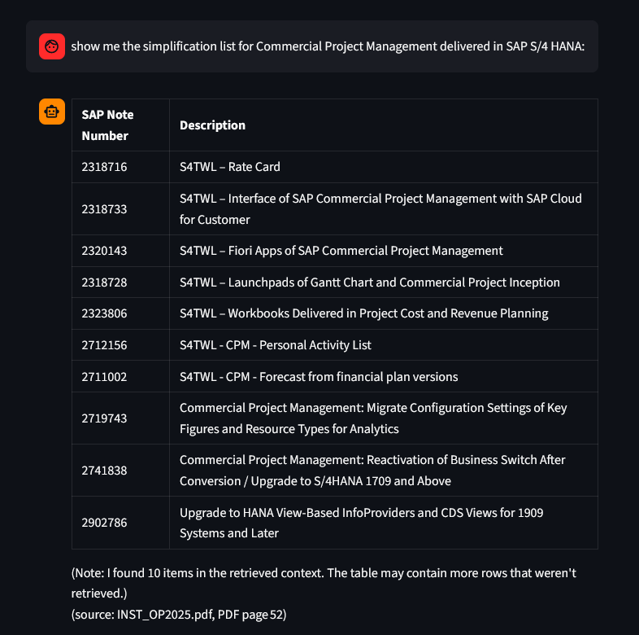
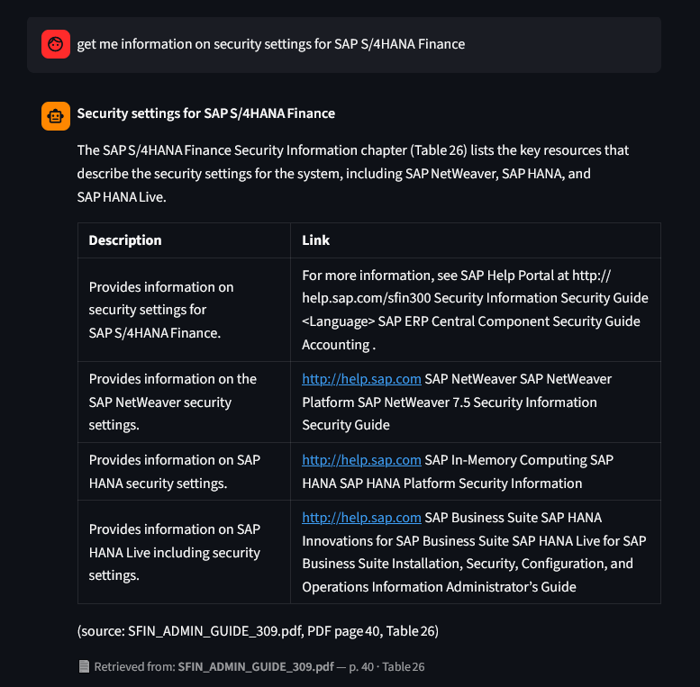
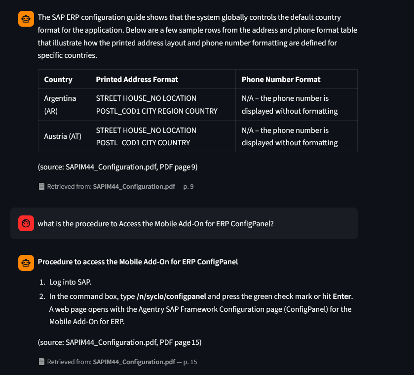
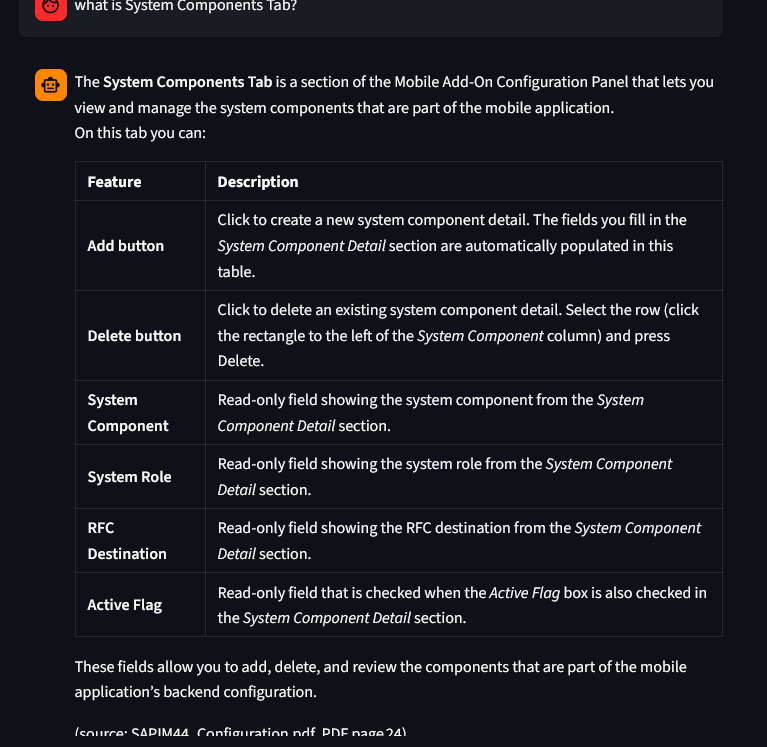
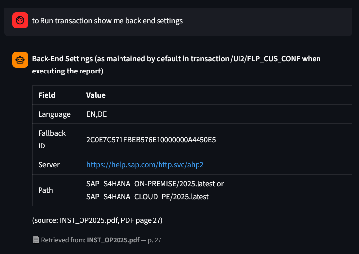
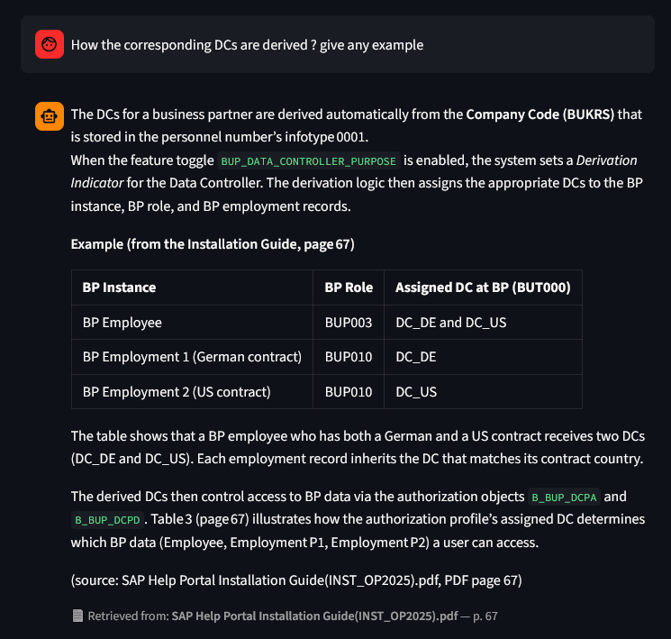
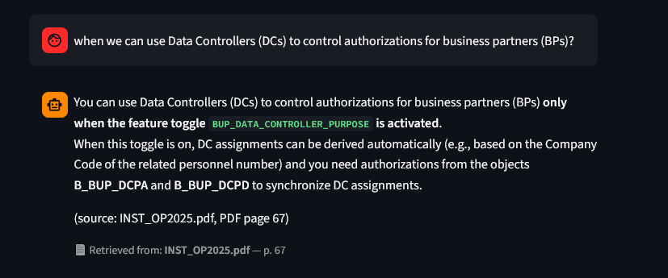
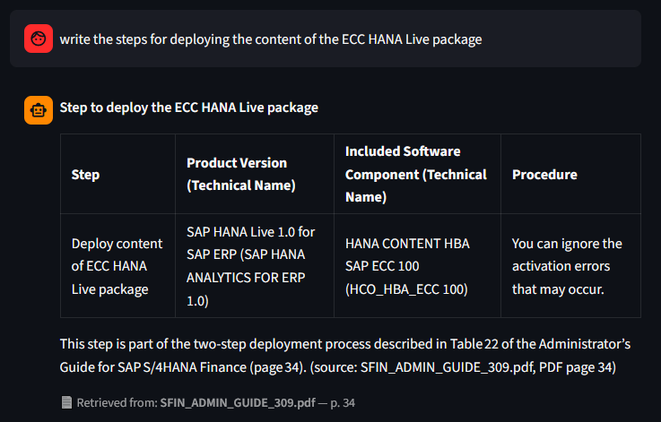

ERP Doc RAG Chatbot — 100% Accurate Table & T-Code Search

A specialized Retrieval-Augmented Generation (RAG) system built specifically for complex enterprise documentation (SAP, Oracle, Microsoft Dynamics).

Standard AI tools fail on ERP documents. They hallucinate T-Codes, miss the bottom rows of massive tables, and misquote configuration steps. This project uses a Hybrid Search Architecture (BM25 + Vector + Reranker) to ensure perfect extraction of structured technical data, with exact page-level citations.

    💡 Note: This is a closed-source demonstration tool. The architecture and screenshots are provided here. The full desktop application is available upon request.

🎯 The Problem with Standard RAG on ERP Docs

    Dense Tables: ERP manuals are full of 10+ row tables (e.g., SAP Note lists). Vector search alone often cuts off the bottom half of these tables.

    Exact Acronyms: Standard embedding models treat OBY6 and OBY5 as almost identical. This leads to hallucinated configuration steps.

    Lack of Citations: Consultants need to verify the exact PDF page before applying a configuration to a client's live system.

🛠️ The Solution: Hybrid Search Architecture

To solve this, the standard FAISS vector search was upgraded to a two-stage retrieval pipeline:

    BM25 (Keyword Search): Catches exact T-Codes, Table names, and SAP Note numbers.

    Vector Search (Semantic): Understands the context of the question.

    Reranker: Takes the top 20 chunks from BM25 and Vector search, and re-ranks them to ensure the most accurate context is passed to the LLM.

    Strict Mode: Forces the LLM to answer only from the retrieved context. If the answer is not in the PDF, it refuses to guess.

🖼️ Real Output Examples

### 1. "Extracting Large Tables without Data Loss"
*Prompt: "show me the simplification list for Commercial Project Management delivered in SAP S/4 HANA"*
The system perfectly extracted a 10-row table of SAP Notes and cited the exact PDF page (Page 52).

### 2. "Extracting Security settings steps for SAP S/4HANA Finance"
*Prompt: "get me information on security settings for SAP S/4HANA Finance"*
The system perfectly extracted all Security settings steps for SAP S/4HANA Finance in a table plus Key configuration steps (Installation Guide) and cited the exact PDF page (Page 35).

### 3. T-Code FBL1N
*Prompt: "explain t-code FBL1N"*
Instant definition of the Vendor Line Item Display transaction.

### 4. "Complex Configuration Steps"
*Prompt: "what is the procedure to Access the Mobile Add-On for ERP ConfigPanel?"*
It extracted a multi-step procedure perfectly formatted as a numbered list.

### 5. "Extracts all features of system component tab"
*Prompt: "what is the procedure to Access the Mobile Add-On for ERP ConfigPanel?"*
It extracted a multi-step procedure perfectly formatted in a table.

### 6. "Back-End Configuration Settings"
*Prompt: "to Run transaction show me back end settings"*
Pulled exact system parameters and fallback IDs from the guide.

### 7. "This is a highly technical, SAP-specific question about Data Controllers (DCs), Business Partners (BP), and Authorization Objects"
*Prompt: "It successfully grabbed the text explaining the logic (Company Code BUKRS + Infotype 0001 + feature toggle)"*
 it pulled the exact example table showing the BP Instance, BP Role, and the assigned DCs (DC_DE, DC_US)

### 8. "When to use Data Contollers(DCs) to control authorization for BPs"
*Prompt: "It extracts exact procedure when to use DCs"*
With exact pdf file name and page No 67

### 9. "Extracts steps for deploying the content of ECC HANNA"
*Prompt: "Show the step in a table with proper heading"*
With exact pdf file name and page No 34

🎥 Video Walkthrough

Watch the full 5-minute demo showing the hybrid search in action, extracting tables, T-Codes, and backend settings from 500-page SAP manuals.

https://www.youtube.com/watch?v=3i1zn385caQ

✨ Key Features

    Hybrid Search (BM25 + Vector): Best-in-class retrieval for both natural language questions and exact acronyms.

    Semantic Reranker: Guarantees the most relevant table rows are passed to the LLM.

    Strict Citation Mode: Every answer includes (source: filename.pdf, PDF page N).

    Ruled Table Extraction: Uses pdfplumber to keep table rows intact, preventing chunks from splitting mid-table.

    100% Local Privacy: Runs entirely on your machine. Your proprietary ERP documents never leave your laptop.

📥 How to Use (Desktop App)

    Download the installer (coming soon to Gumroad).

    Open the app and enter your Groq or OpenAI API key.

    Upload your ERP documentation (PDFs).

    Ask questions in plain English.

🔒 Privacy & Trust

    Built by Suhail Asghar (MCS, freeCodeCamp certified)

    No data leaks: 100% local execution. Only the extracted text chunks are sent to the LLM provider.

    No hallucination: Strict mode ensures the AI does not invent T-Codes.

🏷️ Tags

SAP · ERP · RAG · LangChain · BM25 · Reranker · Vector Database · Enterprise Search · Python · FAISS · LLM

Developed by Suhail Asghar
📧 Email: autopyai@gmail.com
🔗 LinkedIn: linkedin.com/in/your-handle
🌐 Portfolio: autopyai.github.io
